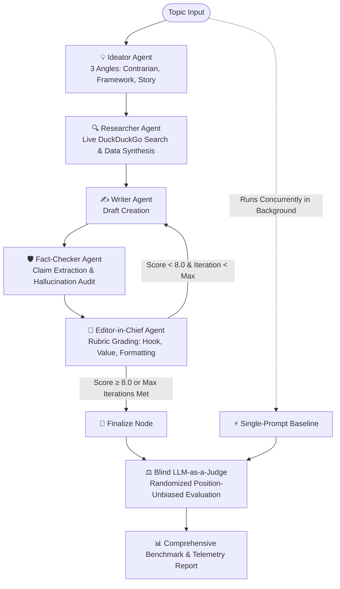

# 🚀 Multi-Agent Content Orchestration & Benchmarking Pipeline

An autonomous, multi-agent content generation and evaluation system built with **LangGraph**, **LangChain**, and **Google Gemini**.

This system coordinates a team of five specialized AI agents in a cyclic revision loop to research, draft, fact-check, and edit high-impact content. It also benchmarks output quality, latency, token consumption, and dollar cost against a concurrent single-prompt baseline using a blind LLM-as-a-judge.

---

## 🏗️ Architecture & Workflow

The pipeline models content creation as a directed state machine with conditional feedback loops:



---

## 🤖 The Multi-Agent Team

Each agent in the pipeline is specialized with tailored system prompts, structured Pydantic schemas, and optimized model assignments:

| Agent | Model | Primary Responsibility |
| :--- | :--- | :--- |
| **💡 Ideator** | `gemini-3.5-flash-lite` | Generates 3 distinct narrative angles (*Contrarian / Hot Take*, *Actionable Framework*, *Personal Story*) and selects the strongest hook. |
| **🔍 Researcher** | `gemini-3.5-flash-lite` + `DDGS` | Queries DuckDuckGo for live industry statistics, concrete case studies, and citations. |
| **✍️ Writer** | `gemini-3.5-flash` | Drafts and revises content incorporating research, previous critique, and required fact-check corrections. |
| **🛡️ Fact-Checker** | `gemini-3.5-flash-lite` | Audits drafts against research notes, flags unverified/contradicted claims, and identifies hallucinations. |
| **📝 Editor-in-Chief** | `gemini-3.5-flash` | Evaluates drafts on a 1–10 rubric (Hook, Value, Formatting) and controls cyclic loop routing (`ready_to_publish` flag). |

---

## ⚡ Key Highlights

- **Cyclic Feedback Loops:** Employs LangGraph conditional edges to route drafts back to the Writer until the Editor's quality threshold is met or the iteration ceiling is reached.
- **Strict Pydantic Validation:** All agent outputs adhere to Pydantic schemas (`AngleOptions`, `FactCheckReport`, `EditorCritique`, `BlindEvaluation`), guaranteeing deterministic parsing.
- **Real-Time Web Grounding:** Uses DuckDuckGo search integration to inject fresh, external facts and reduce model confabulation.
- **Concurrent Baseline Execution:** Runs a single-prompt baseline concurrently in a background `ThreadPoolExecutor` while the multi-agent pipeline executes.
- **Blind LLM-as-a-Judge Evaluation:** Randomizes candidate ordering (`Draft A` vs `Draft B`) to eliminate positional bias, scoring both systems across hook strength, substance depth, and readability.
- **Granular Cost & Latency Telemetry:** Tracks input/output token counts, execution latency, and exact dollar costs per agent using custom model pricing tables.

---

## 📊 Benchmark & Telemetry Output

When execution finishes, the pipeline renders a side-by-side terminal comparison using `rich`:

```text
================================================================================
    BENCHMARK REPORT: Multi-Agent Pipeline vs. Single-Prompt Baseline
================================================================================
┌──────────────────────┬────────────────────────┬──────────────────────┬───────────────────┐
│ Metric               │ Single-Prompt Baseline │ Multi-Agent Pipeline │ Delta / Difference│
├──────────────────────┼────────────────────────┼──────────────────────┼───────────────────┤
│ Total Tokens         │ 842                    │ 5,420                │ +4,578 (6.4x)     │
│ Total Latency        │ 2.45s                  │ 8.92s                │ +6.47s (3.6x)     │
│ Total Cost ($)       │ $0.00018               │ $0.00142             │ +$0.00124         │
│ Judge Quality Score  │ 6.8 / 10               │ 8.9 / 10             │ +2.1 pts          │
└──────────────────────┴────────────────────────┴──────────────────────┴───────────────────┘

🏆 Winner: Multi-Agent Pipeline
Judge Analysis: Multi-Agent post included concrete statistics, stronger hook rhythm, and zero filler.
```

---

## 📁 Repository Structure

```text
content-pipeline-multi-agent/
├── main.py                     # CLI entry point, execution orchestrator & live streaming
├── requirements.txt            # Project dependencies
├── test_connection.py          # API connection test script
└── src/
    ├── config.py               # Model configurations, pricing rules & environment settings
    ├── state.py                # PipelineState TypedDict & Pydantic schemas
    ├── graph.py                # LangGraph StateGraph definition & conditional edges
    ├── baseline.py             # Single-prompt baseline implementation
    ├── evaluate.py             # Blind LLM-as-a-Judge evaluation & comparison report
    ├── tracker.py              # Telemetry tracking for latency, tokens, and cost
    └── agents/
        ├── ideator.py          # Ideation agent
        ├── researcher.py       # Web search & research synthesis agent
        ├── writer.py           # Drafting & revision agent
        ├── fact_checker.py     # Claim verification & hallucination detector
        └── editor.py           # Editor-in-Chief & rubric scoring agent
```

---

## 🛠️ Getting Started

### Prerequisites

- **Python 3.10+**
- A **Google Gemini API Key** (from [Google AI Studio](https://aistudio.google.com/))

### Installation

1. **Clone the repository:**
   ```bash
   git clone https://github.com/yashraorane25/content_pipeline_multi_agent.git
   cd content_pipeline_multi_agent
   ```

2. **Create and activate a virtual environment:**
   ```bash
   python -m venv venv
   source venv/bin/activate  # On Windows: venv\Scripts\activate
   ```

3. **Install dependencies:**
   ```bash
   pip install -r requirements.txt
   ```

4. **Configure environment variables:**
   Create a `.env` file in the root directory:
   ```env
   GEMINI_API_KEY=your_gemini_api_key_here
   FAST_MODEL=gemini-3.5-flash-lite
   SMART_MODEL=gemini-3.5-flash
   ```

---

## 🚦 Usage

### Run the Pipeline Interactively:
```bash
python main.py
```
You will be prompted to enter a topic.

### Run with a Custom Topic via CLI:
```bash
python main.py "Why 90% of AI agent startups will fail because they ignore orchestration and evaluation"
```

---

## ⚙️ Configuration

You can customize execution parameters in `src/config.py`:

| Parameter | Default | Description |
| :--- | :--- | :--- |
| `FAST_MODEL` | `gemini-3.5-flash-lite` | Lightweight model for ideation, search synthesis, and fact-checking |
| `SMART_MODEL` | `gemini-3.5-flash` | Reasoning model for drafting, editing, and final judging |
| `MAX_REVISION_ROUNDS` | `2` | Maximum number of feedback loops allowed |
| `TARGET_QUALITY_SCORE` | `8.0` | Minimum rubric score required to bypass further revisions |
| `PRICING` | Dictionary | Token cost mapping per million tokens used to calculate dollar cost |

---

## 📄 License

This project is licensed under the MIT License.
